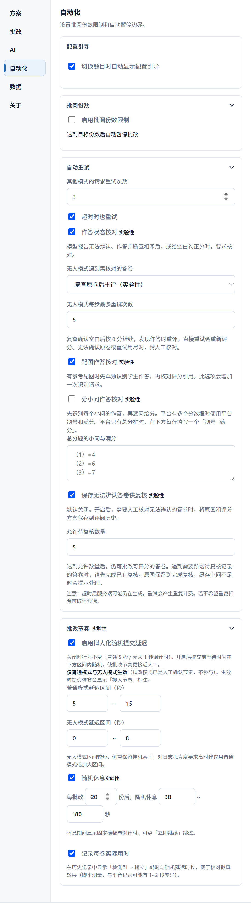

# 配置指南

在阅卷页打开「批改配置」。在「AI」中连接服务并选工作流，在「批改」中选择运行模式、填写批改资料和分数设置。把不同题目的配置保存在各自的场景方案中。

::: info 移动端用户
如果你在手机上浏览，可以点击页面左上角的 **☰ 菜单按钮** 展开侧边目录，在各章节之间切换。
:::

## 输出模式

设置面板的 **「批改 → 输出模式」** 可切换 AI 的输出详细程度：

| 模式 | 输出内容 | 适用场景 |
|---|---|---|
| **详细（默认）** | 识别答案、评分依据、分数计算、分数与评语 | 核对作答、保留评分说明、优化评分标准 |
| **精简（仅分数，实验性）** | 侧重分数；具体省略项随单评、双评及仲裁而定 | 已核对评分规则、希望减少输出等待 |

精简模式减少长篇说明，实际速度取决于模型、题目和图片数量。确认窗口会说明本轮省略的内容，仍可查看本轮使用的答卷图片。

::: warning 精简模式的使用建议
- 单模型评分通常省略识别答案、评分依据、分数计算和评语；双评与仲裁可能保留合并说明或仲裁说明。
- 纠错中的「提示词优化」需要识别答案；本轮省略识别答案时，可仅修改分数，或切回详细模式重新批改后优化。
- 历史记录与导出中的说明内容以本次实际输出为准。
- 需要核对识别结果或留存完整评分说明时，选择**详细**模式。
:::

## 自动化设置

在「批改配置 → 自动化」中可以控制换题引导、批阅份数、自动重试和批改节奏。更改后点击「保存并启用」。

- **配置引导**默认开启，切换到需要配置的题目时会提示你检查或填写方案。要在运行时检测换题并暂停，在「批改 → 答卷校验」中设置[题号变化时暂停批改](/modes/#题号变化时暂停)。
- **批阅份数**可在成功提交达到目标时暂停。设置方法见[批阅份数与达标自动暂停](/modes/unattended#批阅份数与达标自动暂停)。
- **自动重试**分别设置无人模式每步的重试次数和其他模式的模型请求重试次数。这里也可设置作答核对方式和是否保存待复核答卷。各项默认值见[自动重试配置](/modes/unattended#自动重试配置)和[答卷核对与待复核](/modes/unattended#答卷核对与待复核)。

下图是自动化设置示例。勾选状态、核对策略和填写的数值仅用于演示，请按本题需要设置。新方案需要核对时默认暂停，保存待复核、随机提交延迟和随机休息默认关闭。

<a :href="automationExample">查看自动化设置原图</a>

## 批改节奏（实验性）

在设置面板的 **「自动化 → 批改节奏」** 中，可配置随机提交延迟和批量阅卷间的休息，**默认关闭**。

| 配置 | 默认 | 说明 |
|---|---|---|
| 拟人化随机提交延迟 | 关 | 开启后提交前等待在配置区间内随机抽取 |
| 普通模式延迟区间 | 5～15 秒 | 下限低于 5 秒时，留给教师查看评分的时间可能较短 |
| 无人模式延迟区间 | 0～8 秒 | 抽到 0 秒时立即提交 |
| 随机休息 | 关 | 开启后默认每批改 20 份，等下一份出现后随机休息 30～180 秒。可点击「立即继续」跳过 |
| 记录每卷实际用时 | 勾选 | 批改节奏生效时，可在评阅历史中查看从开始处理到提交的用时和随机延迟 |

随机提交延迟只用于普通模式和无人模式，两者可分别设置 0～300 秒的等待区间。关闭后恢复普通模式 5 秒、无人模式 1 秒的默认倒计时。试改模式始终等待教师确认。

## 快速导航

1. **[AI 接口配置](/config/api-setup)** — 连接五加一账号或配置服务商的 API 密钥
2. **[批改工作流](/config/workflow)** — 配置 AI 模型、双评模式和思考链深度
3. **[评分规则](/config/rubric)** — 自定义评分标准，让 AI 按照你的要求打分
4. **[分小题配置](/config/sub-questions)** — 将大题拆分为多个小题分别评分
5. **[预设方案管理](/config/presets)** — 保存不同题目的配置方案，支持自动切换

<CardGrid>
<Card title="AI 接口配置" href="/config/api-setup" description="连接五加一账号或配置 API 密钥，测试批改线路" />
<Card title="批改工作流" href="/config/workflow" description="配置 AI 模型、双评仲裁模式和思考链深度" />
<Card title="评分规则" href="/config/rubric" description="自定义评分标准，让 AI 按照你的要求打分" />
<Card title="预设方案管理" href="/config/presets" description="为不同题目保存不同的配置方案，支持 URL 绑定自动切换" />
<Card title="分小题配置" href="/config/sub-questions" description="将一道大题拆分为多个小题分别评分，如作文分内容/语言/结构" />
</CardGrid>

::: tip 建议配置顺序
1. **AI 接口配置** → 首先配置 AI 服务（必须）
2. **批改工作流** → 选择合适的 AI 模型和批改方式
3. **评分规则** → 设定评分标准
4. **分小题配置** → 如需分小题评分，按需配置
5. **预设方案管理** → 保存配置以便复用
:::

---

**其他分区**：[入门指南](/guide/) · [批改模式](/modes/) · [支持平台](/platforms/) · [进阶功能](/advanced/)
