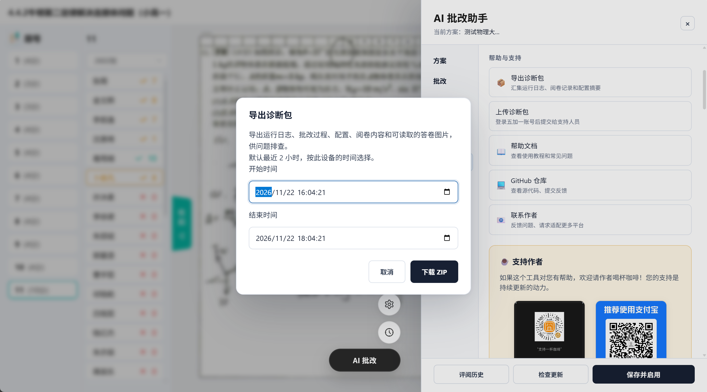

# 常见问题

## 安装与环境

### 手机能用吗？

可以在支持 Tampermonkey 扩展的 Android 平板 Edge 上使用。手机端若能安装扩展、开启用户脚本并打开对应平台的网页版阅卷页，也可尝试。正式阅卷优先使用电脑或平板，方便同时核对答卷和得分。 [平板 Edge 安装步骤](./installation#平板-edge-安装)

### 用什么浏览器？

电脑端推荐 Edge。Chrome、Firefox 等支持 Tampermonkey 的浏览器也可使用。打开阅卷链接时，请使用已经安装脚本的浏览器。 [通用扩展安装指南](./userscript-install)

### 什么是 Tampermonkey（油猴）？

Tampermonkey 是一个免费的浏览器扩展（插件），它可以让浏览器运行额外的脚本程序。AI 批改助手就是通过它来运行的。你只需要安装一次，之后脚本会自动更新。

### 稳定版、预览版、开发版有什么区别？

AI 批改助手提供三个版本渠道：

| 渠道 | 说明 | 安装方式 |
|------|------|---------|
| **稳定版** | 经过充分测试，推荐日常使用 | [一键安装](https://auto-update.aimarking.five-plus-one.com/ota/ai_marker.user.js) |
| **预览版** | 包含最新功能，可能不够稳定 | [一键安装](https://auto-update.aimarking.five-plus-one.com/ota/preview/ai_marker.user.js) |
| **开发版** | 面向开发者的自动构建版本 | 不提供公开安装链接 |

安装后可以在脚本设置中随时切换渠道。如遇到问题，建议切换回稳定版。

### 安装后看不到浮动按钮？

脚本只在阅卷页面（能看到答题卡图片和分数输入框的页面）上才会激活。请确认：

1. 当前页面是已支持平台（如智学网、七天网络、好分数等，完整列表见下方「平台相关」）的阅卷页面
2. 页面上能看到学生答题卡图片
3. Tampermonkey 扩展已启用（浏览器右上角图标为黑色，不是灰色）

::: tip 通用油猴脚本安装教程
油猴脚本的安装（Tampermonkey 扩展 + 允许用户脚本）是**所有脚本的通用步骤**，已整理为独立页面：**[油猴脚本安装指南](/guide/userscript-install)**，含 Edge 新旧版 / Chrome 完整图文与常见问题。
:::

### 篡改猴弹出「请启用"允许用户脚本"」提示怎么办？

点击浏览器右上角篡改猴图标，如果顶部出现**蓝色提示条**：

说明**扩展还没被允许运行用户脚本**，脚本不会生效。按下面的方法开启后刷新页面即可。

### 如何确认脚本已正常启用？

点击浏览器右上角的篡改猴图标：

**✅ 正常** —— 显示「✓ 已启用」，下方列出 AI-Marker-Suite：

**❌ 异常** —— 顶部出现蓝色提示「请启用"允许用户脚本"扩展设置」（见上一条）。

### Chrome 浏览器如何启用用户脚本？

打开 Tampermonkey 的扩展详情，开启「允许用户脚本」，然后刷新阅卷页。扩展详情没有该开关时，参照[用户脚本权限指南](./userscript-install)。

### 旧版 Edge 没有「允许用户脚本」选项怎么办？

新版 Edge 的扩展设置里有「允许用户脚本」开关；**部分旧版 Edge 没有这一项**。此时打开 **「开发人员模式」** 开关即可：

### 脚本已启用但页面上还是没有按钮？

1. 确认当前是**阅卷页面**（能看到答题卡图片和分数输入框），脚本只在这种页面激活
2. 确认平台在支持列表内（见下方「平台相关」）
3. **刷新页面**——脚本启用后需要刷新才会在已打开的页面上生效
4. 点击篡改猴图标确认没有「请启用允许用户脚本」的蓝色提示

## 基本使用

### 识别不准怎么办？

先核对答卷图片是否完整，再填写题目、参考答案和评分标准。用试改模式查看识别出的作答和评分依据，按样卷调整给分点后再继续。 [评分规则](../config/rubric)

### 遇到 403 错误怎么办？

答卷图片返回 403 时，助手会刷新页面尝试恢复。如果仍无法读取，先确认阅卷平台仍处于登录状态，再重新打开待阅答卷。若是 AI 接口返回 403，可在「批改配置 → AI」检查账号连接或密钥权限。

### 无人值守模式安全吗？

先试改几份样卷，核对分数和原站保存结果，再开启连续批改。可设置批阅份数限制、每步重试次数和需核对答卷的处理方式。出现无法确认的答卷或保存结果时，按助手提示核对。 [无人值守模式](../modes/unattended)

### 支持哪些题型？

助手用于作文、解答题、论述题和简答题等主观题。对应平台能否读取答卷、分小题给分和保存，以[各平台指南](/platforms/)列出的任务为准。客观题可用阅卷平台自带的功能判分。

### 怎么停止批改？

点击右下角的浮动按钮暂停，在弹窗中点击「取消并退出」即可停止。

### 弹窗没出现？

先刷新阅卷页，等待答卷图加载，再查看右下角是否有助手入口。仍有问题时，可以从油猴菜单导出诊断包。

### 怎么导出诊断包？

1. 打开 **批改配置 → 关于 → 帮助与支持 → 导出诊断包**。也可在 Tampermonkey 菜单选择「导出诊断包」。
2. 选择问题发生的时间范围，默认最近两小时，时间按当前设备显示。
3. 点击「下载 ZIP」。压缩包可能包含运行日志、批改过程、阅卷记录、配置和可读取的答卷图片。发送前核对内容，随后通过[帮助与支持](/support#诊断包)联系维护者。

在同一位置选择「上传诊断包」，可登录五加一账号后向支持人员提交日志、阅卷结果和配置摘要。

## 配置相关

### API 密钥在哪里获取？

使用五加一服务时，可直接在阅卷页登录五加一账号连接。需要手动配置时，可在[管理控制台的 API 密钥页](https://platform.ai.five-plus-one.com/sign-in?provider=5plus1-account&redirect=%2Fkeys)创建密钥，再填入助手。自定义供应商请选择支持图片输入的模型。 [AI 接口配置](../config/api-setup)

### 5plus1API 连不上或提示余额不足怎么办？

打开 **批改配置 → AI → 批改线路**，先点「测试线路」。如果当前线路仍不可用，可从线路设置选择另一条官方线路后重试。余额不足时，在 AI 页点「余额与充值」，到账后继续。 [官方线路与余额说明](../config/api-setup#余额与充值)

### 支持哪些 AI 服务商？

任何兼容 OpenAI `/v1/chat/completions` 接口且**支持图片输入（多模态）**的服务商都支持：

- **5+1 AI**（推荐，内置默认配置）
- 火山引擎（豆包）
- 硅基流动

::: tip 按服务的图片处理能力选择
5+1 AI 内置 aimarker-fast、aimarker-pro 与 DeepSeek Flash 配置。使用自定义供应商时，请确认该端点和模型能接收答题卡图片；仅支持文本的端点不适用于图片阅卷。
:::

### 怎么为不同题目保存不同配置？

使用**预设方案管理**功能。详见 [预设方案管理](../config/presets)。

简单来说：

1. 创建新方案，填写题目内容、标准答案、评分标准
2. 将方案绑定到对应题目的 URL
3. 之后打开该题目时会自动切换到对应方案

### 配置会丢失吗？

方案、供应商和工作流保存于当前浏览器，可在「批改配置 → 数据」导出 JSON，换浏览器时再导入。配置文件可能包含 API 密钥，请妥善保存。浏览器偏好可在新浏览器中按需设置。 [方案管理](../config/presets)

## 批改相关

### 分数计算正确，但小题得分与总分不一致？

请更新至 **1.21.22.0 及以上稳定版**，重新打开阅卷页面后先试改核对。该版本完整读取小题给分算式，并按小题明细汇总总分。例如 `1+0+2=3`、`0+0+0+1=1`、`0` 对应小题得分 **3、1、0**，总分 **4**。此修复适用于各平台的多小题评分、双评与仲裁。

已保存的历史成绩需要教师结合评分标准核对，并在平台中复核需要调整的答卷。

### 分数填入失败？

可能是阅卷平台页面结构发生了变化。请检查：

1. 当前页面是否为批改页面（包含答题卡和分数输入框）
2. 脚本是否为最新版本
3. 控制台是否有报错信息

### AI 一直返回 "未能识别"？

可能的原因：

1. 图片质量太低或图片加载失败
2. AI 服务暂时不可用
3. API 密钥额度用尽

建议在设置面板中切换到「流式输出」模式，查看 AI 的实时响应。

### AI 返回结果不完整 / 被截断怎么办？

深度思考类模型可能把输出额度消耗在思考链上，导致正式回答被截断、解析不到分数。可按以下步骤调整：

1. 打开配置面板「批改工作流」→ 编辑当前工作流
2. 勾选「限制单次回答长度」并设置上限（默认 2048）
3. 保存后重新批改

脚本在回答被截断时会自动升级额度重试。详见 [批改工作流](/config/workflow)。

### 纠错功能怎么使用？

在**普通模式**或**试改模式**下，AI 打分后会弹出提交确认对话框。如果分数不准确：

1. 点击对话框中的纠错按钮
2. 输入正确的分数和评分理由
3. AI 会自动分析差异原因，并优化评分标准

详见 [分数纠错](../advanced/correction)。

### 怎么查看批改历史？

点击页面右下角的**历史按钮**（时钟图标），可以查看所有批改记录，支持：

- 按时间、方案筛选
- 查看详情（含答题卡图片）
- 导出为 CSV / JSON / HTML / 材料包ZIP 报告
- 标记需要人工核查的评分，按标记状态集中查看

## 平台相关

### 智学网的续批选项在哪里？

在智学网考试阅卷页打开一份答卷，进入 **批改配置 → 自动化 → 智学网**。其中「本题分配量完成后继续多阅」默认关闭，适用于考试阅卷的无人批改。作业阅卷可在「方案」和「批改」中配置参考答案、评分标准及批改模式。 [智学网使用指南](/platforms/zhixue)

### 园丁邦云阅卷如何使用？

请安装 1.21.25.0 或更新的稳定版脚本，进入普通单评的键盘给分页，核对得分点满分、步长和参考答案后先试改。具体操作见[园丁邦云阅卷指南](/platforms/yuandingbang)。

### 支持哪些阅卷平台？

在[支持平台](/platforms/)中按名称查找阅卷入口、安装要求、适用任务和给分方式。

### 不同平台有什么区别？

部分平台按整题给一个分数，部分平台按小题或给分点评分。进入待阅任务后，按对应指南核对给分方式和提交设置，再用试改确认识别结果。

### 小闲 AI 网上阅卷如何使用？

使用稳定版脚本，进入普通单题、单份答卷的键盘给分页。关闭平台自动提交，核对题目满分和允许的分值后先试改。[小闲 AI 网上阅卷指南](/platforms/xiaoxianai)

### 支持其他阅卷平台吗？

完整支持列表见[支持平台](/platforms/)。如果你需要适配其他平台，请 [联系作者](https://r-l.ink/contact) 或参考 [开发新适配器](../advanced/adapter-dev) 自行开发。

## 反馈与支持

- **问卷反馈**：[填写反馈问卷](https://3dpWmS.rk.r-l.ink/common/channel/redirect/?cid=728548)
- **问题反馈**：[GitHub Issues](https://github.com/five-plus-one/AI-Marker-Suite/issues)
- **联系方式**：[https://r-l.ink/contact](https://r-l.ink/contact)
- **支持作者**：[请作者喝咖啡](http://r-l.ink/support)
